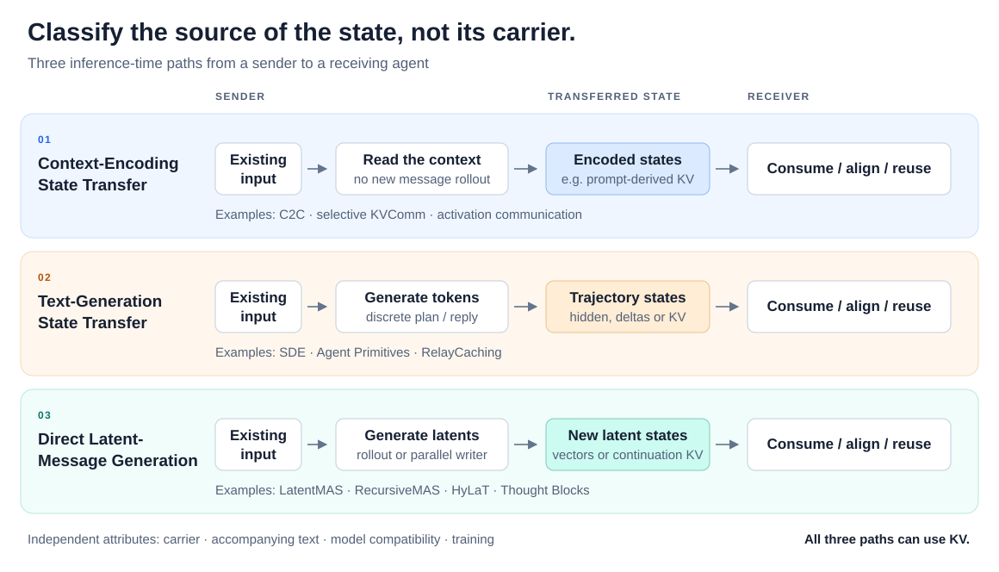

# Awesome Latent Multi-Agent Systems 

A curated collection of research on **latent reasoning and state-based communication in LLM/VLM multi-agent systems**.

 

**Organized by message origin:** context encoding, text generation, or direct latent generation. Embeddings, activations and KV caches describe how the message is carried.

## Contents

- [Scope](#scope)
- [Taxonomy](#taxonomy)
- [Papers](#papers)
  - [Communication Methods](#communication-methods)
    - [Context-Encoding State Transfer](#context-encoding-state-transfer)
    - [Text-Generation State Transfer](#text-generation-state-transfer)
    - [Direct Latent-Message Generation](#direct-latent-message-generation)
  - [Analysis and Safety](#analysis-and-safety)
- [Related Lists](#related-lists)

## Scope

This list covers **latent reasoning and state-based communication in LLM/VLM multi-agent systems**: agent-local continuous reasoning, cross-agent exchange of embeddings, activations and KV caches, and cross-agent state reuse. It also includes analysis, safety research and applications of these mechanisms.

Systems may use shared or heterogeneous models, two or more collaborating agents, and one-way or multi-round interaction. Agent-local latent reasoning can coexist with textual communication, and inter-agent messages may combine latent states with text.

## Taxonomy

| Category | Where do the transmitted states come from? | Representative comparison |
| :--- | :--- | :--- |
| **Context-Encoding State Transfer** | Processing already available inputs, such as documents, observations or shared context. | C2C transfers prompt-derived KV. |
| **Text-Generation State Transfer** | A discrete generation process that produces a plan, reply or other token trajectory. | Agent Primitives transfers KV over generated tokens. |
| **Direct Latent-Message Generation** | Newly generated continuous positions or dedicated latent message blocks, without first generating the corresponding text. | LatentMAS transfers KV accumulated during latent rollout. |

**All three can use KV.** KV is a carrier, not evidence that an agent performed continuous latent reasoning. Likewise, input embeddings can carry either text-derived hidden states or directly generated latents.

- **Classify inference, not supervision.** Text used to train a latent sender does not make its inference-time messages text-generated.
- **Separate variants.** Interlat's base protocol and compressed sender follow different paths. A mixed cache can contain prompt, text and latent positions; its entry identifies the distinguishing mechanism.
- **Keep independent attributes separate.** Carrier, accompanying text, model compatibility and training are properties of a method, not competing categories. “Hybrid” refers to the inter-agent message, not merely textual questions and final answers.
- **Reuse follows its source.** Generic shared-context caching is listed under context encoding; reuse specifically of an upstream decoding trajectory is listed under text generation. Context reuse can also apply to earlier agents' textual messages.
- **Compression preserves provenance.** Pooling or quantizing an existing cache does not by itself turn context encoding into direct latent generation. A writer trained to synthesize new continuation states, such as Thought Blocks, is listed under direct generation.

### Reading the List

Entries use the **arXiv v1 submission date**, newest first within each category; a later paper version does not change that date. For non-arXiv papers, a verified acceptance date is used if available; otherwise the proceedings month is explicitly labeled. Venue names are shown only when supported by a paper, proceedings, or author source. **arXiv** means no venue is asserted here; “under review” is not acceptance.

Code links point to identified implementations. Unofficial or reference implementations are labeled; a missing link means none was verified for this list. Compatibility and training tags summarize the described setup, not guarantees for arbitrary model pairs. Dates and metadata were reviewed on **2026-10-21**; summaries are editorial descriptions, not independent reproductions.

## Papers

### Communication Methods

Communication methods are grouped by how the transmitted states are produced at inference time.

- **[LaMAR: Latent Multi-agent Collaboration via KV-Cache Communication for Automated Program Repair](https://doi.org/10.1145/3832783.3837423)** — **LaMAR**. 
  `2026-10 (proceedings)` · [ASE 2026 Research Papers](https://conf.researchr.org/details/ase-2026/ase-2026-research-track/127/LaMAR-Latent-Multi-agent-Collaboration-via-KV-Cache-Communication-for-Automated-Prog). 
  Connects bug-analysis and repair chains through direct KV-state transfer, with optional iterative refinement. The public abstract confirms the communication interface; its state-generation path remains unverified. 
  KV · Bug-analysis and repair chains

#### Context-Encoding State Transfer

The sender exposes representations formed while processing available context. This includes semantic transfer and shared-context computation reuse; neither requires a new intermediate reasoning message.

- **[Receiver-Conditioned Latent Communication gives 94% CacheBack](https://arxiv.org/abs/2609.32046)** — **CacheBack**. 
  `2026-09-25` · arXiv · [Code](https://github.com/agentcacheback/cacheback). 
  Uses a receiver’s information request to select useful positions from a sender’s existing context cache; the request and returned KV travel in opposite directions. 
  KV + text request · Training-free

- **[Dual-Cache Latent Space Communication between Heterogeneous Language Models](https://arxiv.org/abs/2608.20617)** — **XKV**. 
  `2026-08-20` · arXiv. 
  Conditions a translator on both agents’ context caches, then writes position-specific residuals into the receiver’s native KV representation. 
  KV · Heterogeneous models · Trained interface

- **[See What I See, Know What I Think: Dense Latent Communication Across Heterogeneous Agents](https://arxiv.org/abs/2606.13594)** — **Dense Latent Communication**. 
  `2026-06-11` · arXiv. 
  Aligns dense input-derived KV caches across agents and evaluates shared, missing and complementary receiver context, including a two-sender setting. 
  KV · Heterogeneous models · Trained interface

- **[Latent Cache Flow: Model-to-Model Communication Without Text](https://arxiv.org/abs/2605.22863)** — **LCF / LCF-X**. 
  `2026-05-19` · [ICML 2026 AdaptFM Workshop](https://openreview.net/pdf/ad6e6d97d3d8d92825fa0d2d26b8e6caea4bcd64.pdf). 
  Compresses and jointly translates keys and values; LCF-X pools the sender’s private context into summaries that do not require token-aligned receiver inputs. 
  KV · Heterogeneous models · Trained interface

- **[LRAgent: Efficient KV Cache Sharing for Multi-LoRA LLM Agents](https://arxiv.org/abs/2602.01053)** — **LRAgent**. 
  `2026-02-01` · [ICML 2026](https://hjeon2k.github.io/hyesungjeon.github.io/) · [Code](https://github.com/hjeon2k/LRAgent). 
  Separates reusable base-model caches from agent-specific low-rank contributions, with Flash-LoRA-Attention to reconstruct adapter effects efficiently. 
  KV reuse · Shared base with LoRA agents

- **[Q-KVComm: Efficient Multi-Agent Communication Via Adaptive KV Cache Compression](https://arxiv.org/abs/2512.17914)** — **Q-KVComm**. 
  `2025-11-27` · arXiv. 
  Compresses context-derived KV through layer selection, adaptive quantization and statistical calibration, retaining an explicit channel for extracted key facts. 
  KV + text · Training-free

- **[KVCOMM: Online Cross-context KV-cache Communication for Efficient LLM-based Multi-agent Systems](https://arxiv.org/abs/2510.12872)** — **KVCOMM (Ye et al.)**. 
  `2025-10-14` · NeurIPS 2025 · [Code](https://github.com/FastMAS/KVCOMM). 
  Reuses KV for overlapping text contexts under different agent prefixes, estimating cache corrections from an online anchor pool. Its focus is avoiding repeated prefill; Shi et al.’s similarly named KVComm instead selects layers for semantic communication. 
  KV reuse · Training-free

- **[Cache-to-Cache: Direct Semantic Communication Between Large Language Models](https://arxiv.org/abs/2510.03215)** — **C2C**. 
  `2025-10-03` · ICLR 2026 · [Code](https://github.com/thu-nics/C2C). 
  Projects and fuses prompt-derived KV caches across models; the main interface uses aligned inputs, with an agentic-flow extension in Appendix A.5.3. 
  KV · Heterogeneous models · Trained interface

- **[KVComm: Enabling Efficient LLM Communication through Selective KV Sharing](https://arxiv.org/abs/2510.03346)** — **KVComm (Shi et al.)**. 
  `2025-10-02` · ICLR 2026 · [Code](https://github.com/Zephyroam/KVComm). 
  Selects informative layers of the sender’s context-prefill KV cache for receiver attention; the sender need not generate an intermediate answer. 
  KV · Same model / same-base fine-tunes · Training-free

- **[Communicating Activations Between Language Model Agents](https://arxiv.org/abs/2501.14082)** — **AC**. 
  `2025-01-23` · ICML 2025. 
  Transfers an intermediate activation from one model into another during a forward pass, using direct fusion or an optional learned linear map. 
  Activation · Optional alignment training

- **[DroidSpeak: KV Cache Sharing for Cross-LLM Communication and Multi-LLM Serving](https://arxiv.org/abs/2411.02820)** — **DroidSpeak**. 
  `2024-11-05` · [NSDI 2026](https://www.usenix.org/conference/nsdi26/presentation/liu-yuhan). 
  Reuses shared-context KV across model variants with selective layer recomputation; its MetaGPT evaluation demonstrates reuse in a coder–tester workflow. Published as *DroidSpeak: KV Cache Sharing Across Fine-tuned Model Variants*. 
  KV reuse · Same architecture, different weights

#### Text-Generation State Transfer

The sender follows a discrete generation process, but another agent consumes states associated with that process. This covers hidden-state messages, state-delta side channels, and decoding-to-prefill KV reuse. Discrete diffusion planning is labeled explicitly rather than treated as continuous latent rollout.

- **[StateBridge: Training-free Hidden-state Alignment for Latent Communication in LLM Multi-Agent Systems](https://arxiv.org/abs/2608.13317)** — **StateBridge**. 
  `2026-08-13` · COLM 2026 · [Code](https://github.com/YanwenPneg/StateBridge). 
  Aligns hidden states accompanying a sender’s decoded tokens into a receiver-compatible soft prefix using closed-form geometry and norm calibration. 
  Hidden → input embeddings · Same model · Training-free

- **[Latent-DARM: Bridging Discrete Diffusion And Autoregressive Models For Reasoning](https://arxiv.org/abs/2603.09184)** — **Latent-DARM**. 
  `2026-03-10` · ICLR 2026 LIT Workshop. 
  Passes the final hidden states of a discrete-diffusion planner to an autoregressive executor. These states arise from plan generation via denoising, rather than a continuous autoregressive latent loop. 
  Hidden → input embeddings · Heterogeneous models · Trained projector

- **[RelayCaching: Accelerating LLM Collaboration via Decoding KV Cache Reuse](https://arxiv.org/abs/2603.13289)** — **RelayCaching**. 
  `2026-02-28` · [ICML 2026](https://icml.cc/Downloads/2026) · [Code](https://github.com/YingshengGeng/RelayCaching). 
  Reuses KV created during an upstream agent’s text decoding in the next agent’s prefill, selectively correcting prefix-dependent discrepancies. 
  KV reuse · Training-free

- **[Agent Primitives: Reusable Latent Building Blocks for Multi-Agent Systems](https://arxiv.org/abs/2602.03695)** — **Agent Primitives**. 
  `2026-02-03` · [ICML 2026](https://dream.ischool.illinois.edu/blogs/agent_primitives.html) · [Reference implementation](https://github.com/haibojin001/AgentPrimitives). 
  Builds reusable review, voting and planning operators around KV transfer. The communication mechanism in Section 3.1 passes caches over the prompt and autoregressively generated token sequence. 
  KV · Same model · Training-free

- **[Enabling Agents to Communicate Entirely in Latent Space](https://arxiv.org/abs/2511.09149)** — **Interlat**. 
  `2025-11-12` · ACL 2026 · [Code](https://github.com/XiaoDu-flying/Interlat). 
  Passes plan-generation hidden states to an actor through a trained adapter; the compressed variant in Section 4 instead generates a short continuous latent message directly. 
  Hidden → input embeddings · Trained interface / models

- **[Thought Communication in Multiagent Collaboration](https://arxiv.org/abs/2510.20733)** — **ThoughtComm**. 
  `2025-10-23` · NeurIPS 2025 Spotlight · [Unofficial implementation](https://github.com/AUMEZAK/thoughtcomm). 
  Extracts shared and private latent factors from agents’ response states with a sparsity-regularized autoencoder, then injects structured thoughts through prefix adaptation during debate. 
  Structured latents + text · Trained interface

- **[Augmenting Multi-Agent Communication with State Delta Trajectory](https://arxiv.org/abs/2506.19209)** — **SDE**. 
  `2025-06-24` · [EMNLP 2025](https://aclanthology.org/2025.emnlp-main.518/) · [Code](https://github.com/LittleDinoC/StateDelta). 
  Augments a generated text message with token-wise hidden-state changes, exposing information from the sender’s discrete decoding trajectory. 
  Hidden-state deltas + text · Same model · Training-free

#### Direct Latent-Message Generation

The sender constructs new continuous messages instead of first producing their discrete textual counterparts. This includes autoregressive hidden-state or soft-embedding rollout, compression of such trajectories, and parallel continuation-state writers.

- **[Thought Blocks: Non-Autoregressive Latent Communication for Multi-Agent Systems via Trajectory-to-State Compilation](https://arxiv.org/abs/2610.23056)** — **Thought Blocks**. 
  `2026-10-16` · arXiv. 
  Distills a latent-rollout teacher into a writer that constructs continuation KV blocks in one shot, replacing sequential message generation at inference. 
  KV blocks · Trained writer · Parallel generation

- **[Task-Oriented Key-Layer KV Communication for Efficient Latent Multi-Agent Collaboration](https://arxiv.org/abs/2610.08820)** — **KITE**. 
  `2026-09-24` · arXiv. 
  Selects a task-relevant layer of latent KV continuation state using receiver trajectory distortion, reducing the state needed for downstream latent collaboration. 
  Key-layer KV · Training-free

- **[CondenseFlow: Scalable Latent Space Collaboration via Semantic Compression for Multi-Agent Systems](https://aclanthology.org/2026.findings-acl.669/)** — **CondenseFlow**. 
  `2026-07 (proceedings)` · [ACL 2026 Findings](https://aclanthology.org/2026.findings-acl.669/) · [Code](https://github.com/xxy33/condenseflow). 
  Compresses accumulated KV from latent collaboration with learnable semantic probes, bounding the size of the message transferred between agents. 
  KV compression · Trained probes

- **[LatentDx: Latent Multi-Agent Communication for Cross-Hospital Rare-Disease Diagnosis](https://arxiv.org/abs/2606.13945)** — **LatentDx**. 
  `2026-06-11` · arXiv · [Code](https://github.com/AlexandreWANG915/LatentDx). 
  Hospital agents generate compact latent blocks from local evidence and send them to a host; LatentDx-H uses same-backbone KV blocks and LatentDx-X aligns states across model families. 
  KV / input embeddings · Trained interfaces

- **[HyLaT: Efficient Multi-Agent Communication via Hybrid Latent-Text Protocol](https://arxiv.org/abs/2605.25421)** — **HyLaT**. 
  `2026-05-25` · arXiv · [Code](https://github.com/xymou/hylat). 
  Trains agents to generate and exchange an autoregressive latent segment followed by a concise textual output over multiple interaction rounds. 
  Latent embeddings + text · LoRA / SFT

- **[Recursive Multi-Agent Systems](https://arxiv.org/abs/2604.25917)** — **RecursiveMAS**. 
  `2026-04-28` · [NeurIPS 2026](https://recursivemas.github.io/) · [Code](https://github.com/RecursiveMAS/RecursiveMAS). 
  Uses inner links for continuous latent reasoning and outer links for cross-agent transfer, feeding the last agent’s state back to the first for recursive collaboration. 
  Hidden → input embeddings · Heterogeneous models · Trained links

- **[Learning to Communicate: Toward End-to-End Optimization of Multi-Agent Language Systems](https://arxiv.org/abs/2604.21794)** — **DiffMAS**. 
  `2026-04-23` · arXiv. 
  Uses supervised LoRA adaptation to optimize the encoding and consumption of sequential multi-agent latent KV traces. 
  Latent KV trace · LoRA / SFT

- **[When Less Latent Leads to Better Relay: Information-Preserving Compression for Latent Multi-Agent LLM Collaboration](https://arxiv.org/abs/2604.13349)** — **Less Latent / OBF**. 
  `2026-04-14` · arXiv · [Code](https://github.com/markli404/When-Less-Latent-Leads-to-Better-Relay). 
  Prunes LatentMAS-style KV messages and folds discarded low-rank orthogonal residual information back into retained states. 
  KV compression · Training-free

- **[Vision Wormhole: Latent-Space Communication in Heterogeneous Multi-Agent Systems](https://arxiv.org/abs/2602.15382)** — **Vision Wormhole**. 
  `2026-02-17` · arXiv. 
  Compresses a sender’s latent rollout through a shared reference space and decodes it into a receiving VLM’s image-token interface. 
  Latent → image-token inputs · Heterogeneous models · Trained codec

- **[Latent Collaboration in Multi-Agent Systems](https://arxiv.org/abs/2511.20639)** — **LatentMAS**. 
  `2025-11-25` · ICML 2026 Spotlight · [Code](https://github.com/Gen-Verse/LatentMAS). 
  Generates latent thoughts by feeding aligned hidden states back as inputs, then transfers the resulting layer-wise KV across agents. The cache contains both prompt states and newly generated latent states. 
  KV / input embeddings · Same model · Training-free

- **[Let Models Speak Ciphers: Multiagent Debate through Embeddings](https://arxiv.org/abs/2310.06272)** — **CIPHER**. 
  `2023-10-10` · ICLR 2024 · [Unofficial implementation](https://github.com/chaudatascience/cipher_multiagent_debate). 
  Replaces single-token sampling with probability-weighted embeddings, feeding the continuous vectors back into generation and exchanging them during multi-agent debate. 
  Soft embeddings · Training-free

### Analysis and Safety

Audits, interpretability and safety studies of latent multi-agent interaction.

- **[Safety of Latent Communication in Multi-Agent Systems](https://arxiv.org/abs/2609.39788)** — **Safety of Latent Communication**. 
  `2026-09-30` · arXiv · [Code](https://github.com/Muhammad-Huzaifaa/latent-safety). 
  Studies how trainable latent links affect frozen agents’ safety, including link-level attacks, optimization and repair. 
  Interface safety

- **[Beyond the Transcript: Detecting Covert Coordination in Latent Multi-Agent Communication](https://arxiv.org/abs/2608.19161)** — **Beyond the Transcript / VLA**. 
  `2026-08-19` · arXiv. 
  Combines activation monitoring, counterfactual influence analysis and sparse-autoencoder interpretation to detect covert coordination in a controlled multi-agent auction setting. 
  Monitoring and intervention

- **[When Does Latent Communication Pay? A Causal Audit of Relayed KV Caches in Multi-Agent LLMs](https://arxiv.org/abs/2608.04893)** — **When Does Latent Communication Pay?**. 
  `2026-08-05` · arXiv. 
  Audits relayed KV using mismatched, zero and random caches, testing whether gains depend on sender information unavailable to the receiver. 
  Causal audit

- **[Do Latent Channels Actually Communicate? A Causal Audit of Latent Multi-Agent LLM Communication](https://arxiv.org/abs/2607.26773)** — **Do Latent Channels Actually Communicate?**. 
  `2026-07-29` · arXiv. 
  Uses controlled message substitutions to separate the effect of receiving a message, its example-specific content, and the contribution of another agent. 
  Causal audit

## Related Lists

- [Awesome Latent Space](https://github.com/xlyu0106/Awesome-Latent-Space) — Broader research on latent-space reasoning and communication.
- [Awesome Latent CoT](https://github.com/EIT-NLP/Awesome-Latent-CoT) — Continuous and latent chain-of-thought research, including single-agent methods outside this list's scope.
- [Awesome LLM](https://github.com/Hannibal046/Awesome-LLM) — General LLM papers and resources.

## Contributing

Suggestions and corrections are welcome. Please read [CONTRIBUTING.md](CONTRIBUTING.md), then [suggest a paper](https://github.com/baiyimeng/awesome-latent-mas/issues/new?template=suggest-paper.yml) or open a pull request. Explain **which agents collaborate** and **how the communicated state is produced**, with a pointer to the method or implementation.

The original descriptions and overview diagram are released under [CC0](LICENSE). Linked papers and implementations retain their respective licenses.
